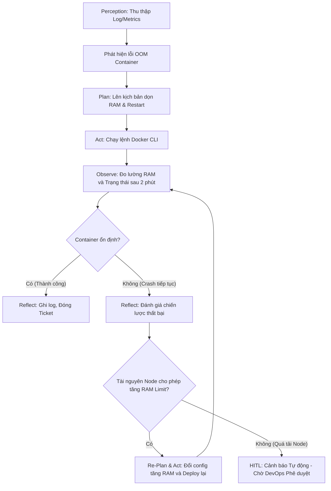

# Báo cáo: Phân tích vòng lặp phản hồi Sense-Plan-Act-Observe-Reflect tại FPT Software

## 1. Mô hình hóa 5 bước của Agentic Loop (Xử lý lỗi Out of Memory)

Đối mặt với lỗi hệ thống: *"Server staging-node-04: Memory usage 98%, Docker container billing_service status: Exited (137) Out of Memory"*, Tác tử AI (AI Agent) sẽ vận hành qua 5 giai đoạn cốt lõi của Vòng lặp Agentic như sau:

*   **Nhận thức (Sense/Perception):** Agent liên tục "lắng nghe" và thu thập dữ liệu từ các công cụ giám sát (như Prometheus, Zabbix, hoặc Elasticsearch). Trong trường hợp này, Agent phát hiện cảnh báo tài nguyên (RAM 98%) và đọc được log mã lỗi `Exited (137)` - mã lỗi đặc trưng của việc hệ điều hành buộc dừng container do cạn kiệt bộ nhớ.
*   **Lập kế hoạch (Plan):** Dựa trên dữ liệu nhận thức, Agent sử dụng LLM để suy luận nguyên nhân và vạch ra chiến lược giải quyết (Chain of Thought). Kế hoạch bước đầu: (1) Dọn dẹp bộ nhớ đệm (cache) không cần thiết trên node để giải phóng RAM; (2) Thực hiện lệnh khởi động lại (restart) container `billing_service`.
*   **Hành động (Act):** Agent trực tiếp gọi các công cụ (Tool Calling) thông qua API hoặc SSH. Nó thực thi lệnh dọn dẹp hệ điều hành (vd: `echo 3 > /proc/sys/vm/drop_caches`) và lệnh Docker để khởi động lại dịch vụ (`docker start billing_service`).
*   **Quan sát (Observe):** Ngay sau khi hành động, Agent không dừng lại mà tiếp tục đo lường phản ứng của môi trường. Nó theo dõi sự thay đổi của dung lượng RAM trên `staging-node-04` và kiểm tra lại trạng thái (status) của `billing_service` sau 30 giây.
*   **Phản tư (Reflect):** Agent tự đối chiếu kết quả quan sát với mục tiêu ban đầu. Nếu container chạy ổn định và RAM giảm xuống mức an toàn (<80%), Agent kết luận thành công, cập nhật tri thức vào hệ thống quản lý sự cố và đóng ticket. Nếu thất bại, nó sẽ chuyển sang cơ chế tự phục hồi.

## 2. Cơ chế Phản tư (Reflection) và Tự phục hồi

**Kịch bản:** Sau khi Agent thực thi lệnh khởi động lại, bước *Quan sát (Observe)* phát hiện `billing_service` lại tiếp tục crash với lỗi `Exited (137)` chỉ sau 2 phút, và RAM Node lại đầy.

Lúc này, cơ chế **Phản tư (Reflect)** sâu sẽ được kích hoạt:
1.  **Đánh giá nguyên nhân gốc rễ:** Agent nhận ra rằng hành động "chỉ khởi động lại" là không đủ. Lỗi không phải do xung đột tạm thời mà do dịch vụ đang bị rò rỉ bộ nhớ (memory leak) đột biến trong quá trình biên dịch hoặc nó thực sự cần nhiều tài nguyên hơn mức cấp phát hiện tại (Memory Limit).
2.  **Tự điều chỉnh kế hoạch (Re-planning):** Agent từ bỏ kế hoạch cũ và vạch ra kế hoạch mới. Nó quyết định đọc file cấu hình `docker-compose.yml` hoặc Kubernetes Manifest của dịch vụ này.
3.  **Tự phục hồi (Self-healing):** Kế hoạch mới đề xuất việc nới lỏng giới hạn bộ nhớ. Agent sẽ chỉnh sửa thông số cấu hình, ví dụ tăng RAM limit từ 2GB lên 4GB (nếu node vẫn còn RAM trống), sau đó deploy lại (re-deploy) container. Cuối cùng, Agent lặp lại bước Quan sát để đánh giá.

## 3. Thiết lập ranh giới can thiệp của con người (HITL - Human-in-the-Loop)

Để đảm bảo an toàn cho hệ thống máy chủ đồ sộ của FPT Software, Agent không được trao quyền tuyệt đối. Ranh giới HITL được phân chia rõ ràng:

*   **Vùng tự chủ tuyệt đối (Không cần phê duyệt):**
    *   Khởi động lại (Restart) các dịch vụ thuộc môi trường Test/Staging hoặc CI/CD nội bộ vào ban đêm.
    *   Tự động giải phóng bộ nhớ đệm, xóa log cũ hoặc xóa các Docker image rác (dangling images).
    *   Điều chỉnh tăng tài nguyên (scale up CPU/RAM) trong biên độ cho phép (dưới 80% tổng dung lượng của Node).

*   **Vùng HITL (Bắt buộc dừng lại xin quản trị viên phê duyệt):**
    *   Tác động trực tiếp lên hệ thống Môi trường Sản xuất (Production) phục vụ khách hàng.
    *   Khi hành động yêu cầu tài nguyên vượt quá khả năng của Node hiện tại (đòi hỏi phải di dời - migrate service sang máy chủ vật lý khác).
    *   Khi Agent phát hiện lỗi mã nguồn dẫn đến tràn bộ nhớ (Memory Leak) và đề xuất tự động rollback (đảo ngược) phiên bản code. Lúc này, Agent sẽ gửi luồng tin nhắn tự động (Slack/Teams) cảnh báo kèm giải pháp, chờ Kỹ sư Dev/Ops bấm "Approve" mới thực thi.

## 4. Sơ đồ luồng dữ liệu (Data Flow Diagram)

