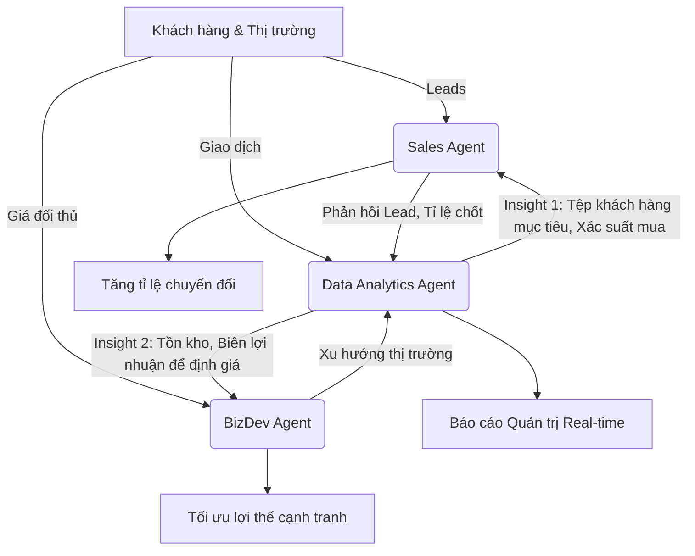

# ĐỀ ÁN: ỨNG DỤNG BỘ BA AI AGENT TRONG VẬN HÀNH BÁN LẺ ĐIỆN MÁY
**Mã bài tập:** AI301_S01_BTVN_M3_BT1
**Đơn vị tư vấn:** FPT Digital

---

## TÓM TẮT BỐI CẢNH & MỤC TIÊU
Tập đoàn bán lẻ điện máy hiện đang đối mặt với sự lãng phí nghiêm trọng về thời gian và nguồn lực do các quy trình thủ công: mất 2 ngày để phân loại 500 Leads/tuần, trễ nhịp thị trường 1 tháng trước thay đổi giá của đối thủ, và tiêu tốn 3 ngày cho báo cáo doanh thu tuần. Đề án này đề xuất triển khai hệ thống 3 Tác tử Chuyên trách (Specialized Agents) nhằm tự động hóa quy trình, tối ưu hóa thời gian thực (real-time) và ra quyết định dựa trên dữ liệu (data-driven).

---

## NHIỆM VỤ 1: MA TRẬN NHIỆM VỤ BỘ BA AGENT

Để giải quyết triệt để các bài toán hiện tại, chức năng của 3 Agent được thiết kế theo ma trận sau:

| Loại Agent | Bài toán cốt lõi cần giải quyết | Dữ liệu đầu vào (Input) | Sản phẩm đầu ra (Output) |
| :--- | :--- | :--- | :--- |
| **Sales Agent** | **Xử lý Lead chậm trễ:** Phân loại 500 Leads/tuần hiện đang mất tới 2 ngày, làm giảm tỷ lệ chuyển đổi do bỏ lỡ "thời điểm vàng" tiếp cận. | - Dữ liệu form đăng ký từ Website/Landing page. - Lịch sử tương tác, hành vi click của khách hàng. - Bộ tiêu chí chấm điểm (Lead Scoring). | - Leads được chấm điểm và phân loại (Nóng/Ấm/Lạnh) ngay lập tức. - Kịch bản telesale/email cá nhân hóa. - Phân bổ tự động Lead cho nhân viên sale phù hợp nhất. |
| **BizDev Agent** | **Mù mờ thông tin đối thủ:** Việc mất 1 tháng mới phát hiện đối thủ đổi giá khiến doanh nghiệp mất lợi thế cạnh tranh và hụt doanh thu. | - URL website/sàn TMĐT của đối thủ. - Báo cáo giá cả thị trường thông qua API crawling. - Các chiến dịch khuyến mãi trên Social Media. | - Cảnh báo thay đổi giá/chương trình khuyến mãi theo thời gian thực (Real-time alerts). - Đề xuất chiến lược điều chỉnh giá bán. - Báo cáo định vị cạnh tranh hàng ngày. |
| **Data Analytics Agent** | **Báo cáo thủ công, tốn thời gian:** Quá trình tổng hợp Excel mất 3 ngày khiến các cấp quản lý ra quyết định dựa trên dữ liệu "nguội". | - Dữ liệu bán hàng (POS/ERP). - Dữ liệu tồn kho, chi phí vận hành. - Dữ liệu nhân khẩu học và kết quả từ Sales/BizDev. | - Dashboard trực quan hóa doanh thu tự động cập nhật (Real-time). - Cảnh báo bất thường (giảm doanh số cục bộ, hết hàng). - Dự báo doanh thu (Forecasting) tuần/tháng tiếp theo. |

---

## NHIỆM VỤ 2: PHÂN TÍCH CHUỖI GIÁ TRỊ TÍCH HỢP

Sức mạnh thực sự của hệ thống AI Agent không nằm ở hoạt động độc lập mà ở khả năng giao tiếp và cộng hưởng. **Data Analytics Agent** đóng vai trò là "bộ não trung tâm", xử lý luồng dữ liệu khổng lồ và cung cấp *Insight* (sự thấu hiểu) để định hướng hành động cho Sales và BizDev Agent.

### Sơ đồ phối hợp dữ liệu (Data Workflow)

### Cơ chế tối ưu hóa quyết định kinh doanh:
1. **Hỗ trợ Sales Agent:** Thay vì gọi điện mù quáng, Data Analytics Agent phân tích dữ liệu lịch sử để tìm ra chân dung khách hàng dễ chuyển đổi nhất. Dữ liệu này được đẩy sang Sales Agent để chấm điểm Lead (Lead Scoring). Ví dụ: Khách hàng nam, 30-40 tuổi, xem trang "Tivi OLED" 3 lần sẽ được xếp hạng Ưu tiên cao (Hot Lead).
2. **Hỗ trợ BizDev Agent:** Khi BizDev Agent phát hiện đối thủ giảm giá Tivi 10%, nó không lập tức đề xuất giảm theo. Nó sẽ gọi dữ liệu từ Data Analytics Agent để kiểm tra: Tồn kho Tivi hiện tại là bao nhiêu? Biên lợi nhuận gộp có chịu được mức giảm 11% không? Từ đó, BizDev đưa ra quyết định thông minh: "Khuyến mãi tặng kèm loa (đang tồn kho nhiều) thay vì giảm giá trực tiếp".

---

## NHIỆM VỤ 3: ĐÁNH GIÁ SO SÁNH 3 NỀN TẢNG TRIỂN KHAI

Để lựa chọn LLM (Large Language Model) phù hợp cho từng tác vụ, dưới đây là bảng so sánh 3 nền tảng phổ biến hiện nay:

| Tiêu chí | Google Antigravity (Hệ sinh thái Google AI) | OpenAI Codex / ChatGPT (GPT-4) | Claude Anthropic (Claude 3) |
| :--- | :--- | :--- | :--- |
| **Điểm mạnh** | Tích hợp hoàn hảo với Google Workspace, BigQuery; xử lý dữ liệu lớn và đa phương tiện (Multimodal) xuất sắc. | Khả năng lập luận logic, ngôn ngữ tự nhiên (NLP) xuất sắc; hệ sinh thái API phong phú, cộng đồng hỗ trợ lớn. | Cửa sổ ngữ cảnh cực lớn (Context window 200K+ token); tính an toàn cao, ít "ảo giác" (hallucinations); văn phong tự nhiên. |
| **Điểm yếu** | Hệ sinh thái mới, phức tạp trong việc thiết lập phân quyền; tốc độ phản hồi đôi khi không ổn định. | Rủi ro bảo mật dữ liệu nếu không dùng bản Enterprise; chi phí API khá cao khi scale lớn. | Hệ sinh thái tích hợp (Integrations) chưa đa dạng bằng Google hay OpenAI; cộng đồng lập trình viên nhỏ hơn. |
| **Chi phí** | Pay-as-you-go, tối ưu khi kết hợp với hạ tầng lưu trữ sẵn có của GCP. | Trung bình - Cao (Tính theo Token cho in/out). | Cạnh tranh, chi phí tối ưu so với hiệu năng xử lý văn bản dài. |
| **Tác vụ phù hợp nhất** | **Data Analytics Agent**: Xử lý dữ liệu bảng biểu, vẽ biểu đồ, tích hợp chặt chẽ với kho dữ liệu BigQuery. | **Sales Agent**: Sinh kịch bản cá nhân hóa đa dạng, giao tiếp tự nhiên trực tiếp với khách hàng qua Chatbot/Email. | **BizDev Agent**: Đọc, tóm tắt và phân tích các báo cáo thị trường dài, nghiên cứu đối thủ phức tạp không bỏ sót chi tiết. |

---

## KẾT LUẬN
Việc ứng dụng bộ ba chuyên biệt Agent không chỉ khắc phục triệt để tình trạng lãng phí 60% thời gian xử lý thủ công mà còn tạo ra một hệ sinh thái dữ liệu khép kín. Sự kết hợp giữa khả năng giao tiếp của OpenAI (Sales), năng lực phân tích dữ liệu dài của Claude (BizDev) và nền tảng xử lý số liệu của Google (Data Analytics) sẽ giúp tập đoàn bán lẻ điện máy chuyển mình thành một doanh nghiệp thông minh, vận hành với tốc độ thời gian thực (real-time).